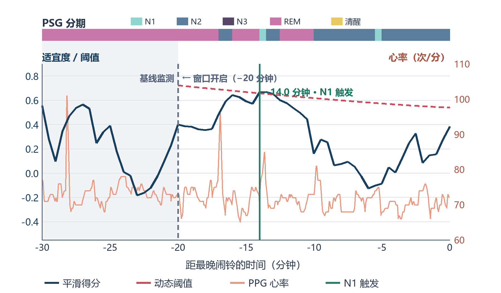
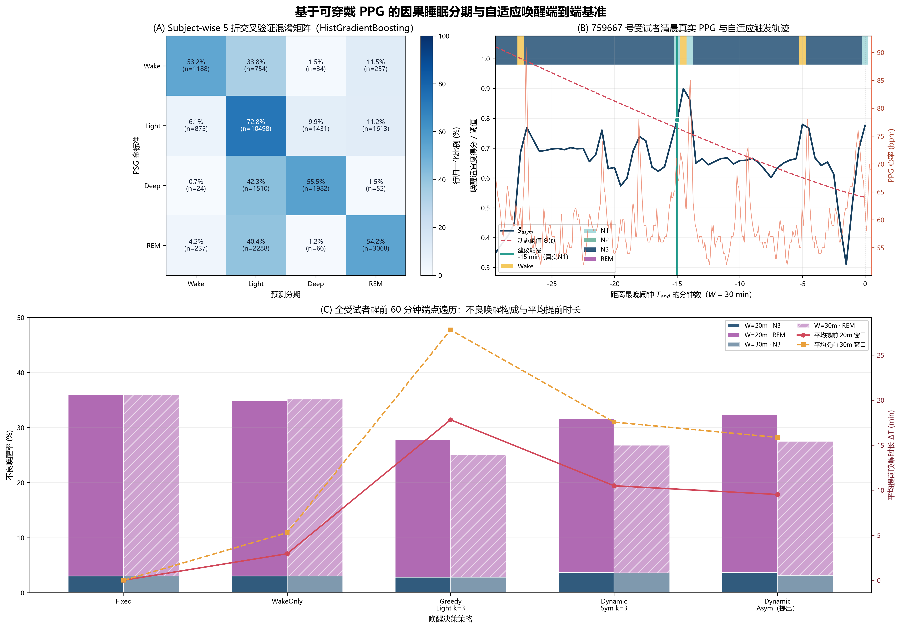
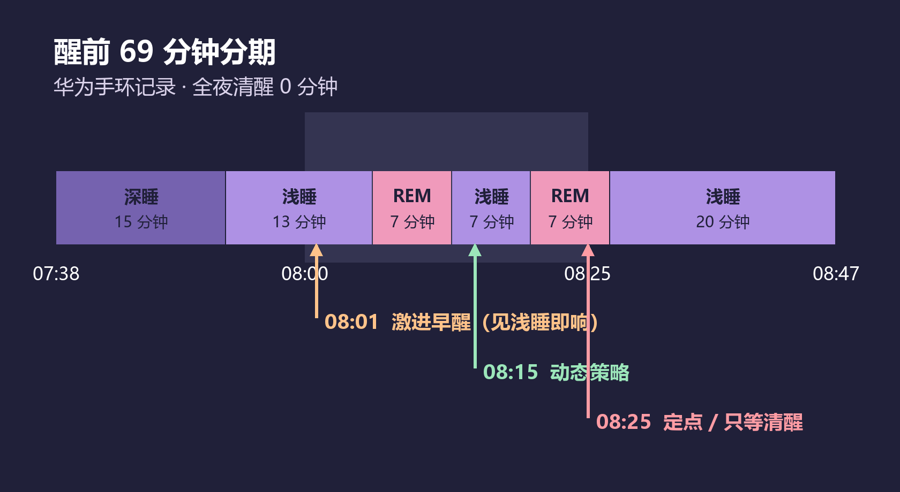
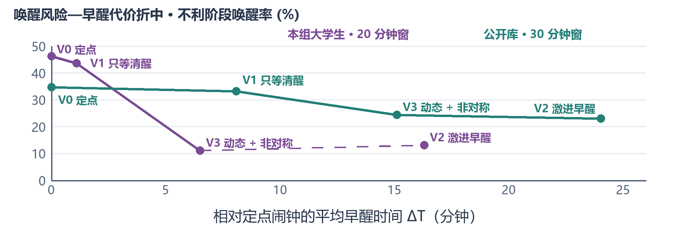
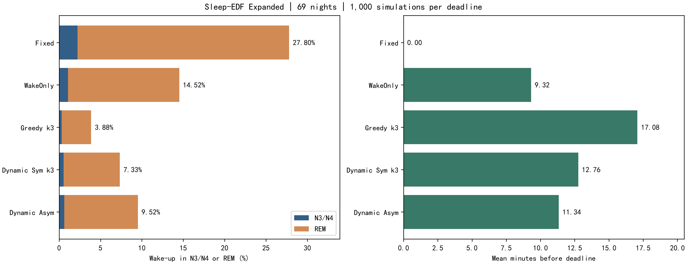

# 基于用户睡眠状态的自适应闹钟：多源数据回测完整技术报告与开源代码

**Group 3 · 韩雪、叶志飞、邵卿宇**

课程展示日期：2026 年 11 月 24 日

## 用几晚的睡眠记录，估算一个唤醒窗口

**打开仓库里的 [index.html](index.html)，下载文件后用浏览器打开。** 手机或电脑浏览器均可打开本地 HTML。点「添加多晚截图」，为每一晚选择一张完整的睡眠分期图。可以一次多选，也可以分次添加。图片只在本机浏览器内处理。裁去图表上下的页面内容后也可测算。请保留整条分期曲线、完整网格和横轴时间。小米报告按提示填写该晚主睡眠段的入睡与醒来时间，重复截取的同一晚只保留一张。

选完后看「多晚测算结果」。**推荐窗口**表示闹钟最多可以提前多久开始寻找唤醒时机。**平均提前量**表示在这个共同窗口下，模拟响铃比预定起床时间平均早了多久。例如，若最晚 07:00 起床，推荐窗口为 10 分钟，闹钟从 06:50 开始寻找时机；实际响铃时刻随当时的分期变化。

结果下方逐晚列出识别到的阶段顺序。请对照原图核对，误读或重复的记录可点「移除」，页面会自动重算。无法读全最后一小时的截图会显示原因，并从联合计算中排除。只有一张有效截图时，页面给出单晚结果。

### 其他配色、分类数和截图比例

v5 提供「按图标定」。上传后，在相应截图旁点「按图标定」，点出主睡眠曲线的左右端点，填写对应时刻，再按图例逐类点选色带中央。点「预览最后一小时」核对顺序，再点「确认纳入」。同一阶段可以取多个颜色或高度。若设备将浅睡与 REM 等合为一类，选「混合或未知」；最后一小时含未识别或混合时段时，页面仅显示预览。

### 想在微信、腾讯文档或 GitHub 留言

**每晚一行，从早到晚写。** 同一阶段再次出现时另写一段。各阶段的总分钟数可以算出深睡和快速眼动（REM）占比；要比较不同长度的唤醒窗口，还需要知道这些阶段在截止前何时出现。可以在页面「单晚核对与分期留言」中复制，也可以照下面的虚构示例填写。公开留言时可用「第几晚」代替个人日期。

~~~text
想用以下两晚的记录估算共同唤醒窗口和平均提前量。设备：____。
第 1 晚，06:00–07:00：深睡 8 分钟 → 浅睡 12 分钟 → REM 9 分钟 → 浅睡 12 分钟 → REM 6 分钟 → 浅睡 8 分钟 → 清醒 5 分钟
第 2 晚，07:10–08:10：浅睡 15 分钟 → REM 10 分钟 → 浅睡 12 分钟 → 深睡 8 分钟 → 浅睡 15 分钟
~~~

只要设备能提供有时间顺序的睡眠分期，就可以按这个格式留言。网页自动读图依赖具体布局。也可以把记录发到仓库的 [GitHub Issues](https://github.com/ZuluFoxt/adaptive-sleep-alarm/issues)。

### 共同窗口怎样选出

网页对每晚最后 60 分钟保留逐分钟顺序，在后 30 分钟逐分钟设置模拟起床截止点。每晚都比较 0、5、10、15、20、25、30 分钟这七种窗口，其中 0 分钟代表定点响铃。每次模拟按触发阶段计分，深睡计 1，REM 计 0.65，浅睡和清醒计 0，每提前一分钟另加 0.02。

每个候选窗口先在单晚内取平均，再对有效夜晚等权取平均，最终选出综合代价最低的共同窗口。页面报告的是**使用这个共同窗口**时的平均提前量。下文的课程原型使用心率预测阶段概率，网页互动回测则直接使用设备给出的阶段标签。

## 研究问题与数据

在只有单通道绿光 PPG 的情况下，闹钟能否把一部分唤醒从 N3 或 REM 移到较合适的阶段，同时减少过早响铃的时间代价？这里将 N3 或 REM 触发计为“不利阶段唤醒”；它是一项回测指标，实际醒后状态仍需通过困倦评分和反应时试验验证。

| 来源 | 样本与设计 | 对应产物 |
| --- | --- | --- |
| 本组大学生手环 | 3 人各 10 晚，共 30 晚，20 分钟窗口 | [组合对照表](data/cohort_comparison.csv)、[个例推演图](figures/huawei_example.png) |
| PhysioNet Sleep-EDF Expanded | 69 晚 PSG，20 分钟窗口，每个截止点 1,000 次模拟 | [策略汇总](data/sleep_edf_alarm_benchmark.csv)、[PSG 图](figures/public_psg_benchmark.png) |
| PhysioNet sleep-accel | 31 人，27,211 个 30 秒片段为随机森林所在实验的数据口径，按受试者五折交叉验证 | [随机森林及同批分期指标](data/ppg_staging_metrics_lr_rf.csv)、[逻辑回归与梯度提升树指标](data/ppg_staging_metrics.csv) |
| sleep-accel 心率流回测 | 逻辑回归与随机森林各 1,889 个 30 分钟窗口；独立梯度提升树汇总每窗口长度 1,831 试次 | [双队列对照](data/cohort_comparison.csv)、[梯度提升树独立汇总](data/ppg_alarm_summary.csv) |

## 分期与唤醒决策

分期特征使用当前及过去 2、5、10 分钟的心率均值与波动、相对基线的变化及 90 秒心率爬升。按受试者分折，避免同一个人出现在同一折的训练集与测试集。梯度提升树三分类准确率为 **76.0%**（宏平均 F1 为 0.647，Kappa 为 0.469），四分类准确率为 **64.7%**（宏平均 F1 为 0.592）。完整折外及逐折结果见 CSV。

$$
S_t=P_t(Wake)+0.6P_t(Light)-0.4P_t(REM)-P_t(N3)+0.20 I_{arousal}.
$$

其中 $I_{arousal}$ 表示由心率爬升标定的微觉醒项，取值 0 到 1。对连续得分做指数平滑：

$$
\bar S_t=\alpha S_t+(1-\alpha)\bar S_{t-1},\qquad
\alpha=\begin{cases}0.40,& S_t\ge\bar S_{t-1}\\0.85,&S_t<\bar S_{t-1}.\end{cases}
$$

在 $[T_{end}-W,T_{end}]$ 内设置 $\tau_t=(T_{end}-t)/W$。

$$
\Theta_t=\Theta_{min}+(\Theta_{max}-\Theta_{min})\tau_t^{1.24}.
$$

窗口内信号有效且平滑得分达到阈值才提前响铃，窗口到期由系统定点响铃。课程方案拟在标定折上估计阈值上下界；代表性图复用先前基准保存的上下界，仅将该试次重新按 1.24 计算。旧基准汇总和旧总图各自保留原计算口径，不能视为 1.24 的全队列结果。

### 公开库试次与完整基准图

8686948 的重算图使用原始 PPG 心率、PSG 分期与梯度提升树折外概率。窗口在 −20 分钟开启，所选试次在 −14.0 分钟的 N1 触发。这幅图展示单个窗口的运行过程。





### 两组人群的策略回测

| 策略 | 本组 20 分钟窗：N3 / N3+REM / 提前 | 公开库 30 分钟窗：N3 / N3+REM / 提前 |
| --- | ---: | ---: |
| V0 定点闹钟 | 13.7% / 46.3% / 0.0 分钟 | 2.91% / 34.73% / 0.0 分钟 |
| V1 只等清醒 | 13.1% / 43.6% / 1.1 分钟 | 2.91% / 33.25% / 8.1 分钟 |
| V2 激进早醒 | 2.1% / 13.1% / 16.3 分钟 | 2.49% / 23.05% / 24.0 分钟 |
| V3 动态阈值与非对称平滑 | 1.5% / 11.1% / 6.5 分钟 | 1.96% / 24.43% / 15.1 分钟 |

本组 20 分钟窗口中，动态策略的 N3 唤醒率从定点的 **13.7%** 降至 **1.5%**，平均提前 **6.5 分钟**。公开库 30 分钟窗口中，动态策略的不利阶段唤醒率从 **34.73%** 降至 **24.43%**，平均提前 **15.1 分钟**。公开库 N3 列采用随机森林口径，合计风险与提前量采用随机森林与逻辑回归等权汇总。两组人群、观测方式和窗口长度均不同。



左侧时间轴的睡眠阶段取自手环记录；三个闹铃时刻属于同一晚的假设性策略推演。30 晚组内结果按现有汇总发布，发布包不包含组员原始个人记录，因此无法从本包独立复算该组结果。



大学生组 V2 的虚线段用于对照。该点同时有更高的不利唤醒率和更多提前时间。公开队列的 V2 更早、风险稍低，反映了目标之间的真实折中。

### Sleep-EDF：69 晚 PSG 模拟

| 策略 | N3/N4 | REM | 不利唤醒 | 平均提前 |
| --- | ---: | ---: | ---: | ---: |
| Fixed | 2.22% | 25.58% | 27.8% | 0.0 分钟 |
| WakeOnly | 1.07% | 13.45% | 14.52% | 9.32 分钟 |
| Greedy_k3 | 0.31% | 3.56% | 3.88% | 17.08 分钟 |
| Dynamic_Sym_k3 | 0.53% | 6.8% | 7.33% | 12.76 分钟 |
| Dynamic_Asym_Proposed | 0.63% | 8.9% | 9.52% | 11.34 分钟 |



## 命令行测算与研究复现

单晚记录也可以用命令行测算。第一种输入按清醒、浅睡、深睡、REM 的顺序提供分钟总数，用于计算阶段占比。第二种输入提供从早到晚的 60 个阶段字符，供单晚窗口回测使用，W、L、D、R 分别表示清醒、浅睡、深睡和 REM。

~~~bash
python diagnose_screenshot.py --minutes 5 32 8 15
python diagnose_screenshot.py --sequence-file my_final_hour.txt
~~~

### 复现公开库基准

建议使用 Python 3.11 或更新版本。先安装依赖，再在仓库根目录运行：

```bash
python -m pip install -r requirements.txt
python scripts/run_ppg_end2end_benchmark.py --data-dir data/sleep-accel --output-dir results/sleep-accel --demo-subject 8686948
python scripts/sleep_edf/download.py
python scripts/sleep_edf/benchmark.py
```

Sleep-EDF 下载脚本按清单校验 PSG 分期文件的 SHA-1。基准脚本默认将汇总与图片写入当前目录。折外预测、原始心率和 PSG 标签由数据源获取，不随本包再分发。要生成新版第 6 页图，可在 sleep-accel 基准脚本生成折外预测后运行：

```bash
python scripts/recreate_trajectory.py --data-dir data/sleep-accel --predictions results/sleep-accel/ppg_oof_predictions.csv --output results/trajectory_gamma124.png
```

公开基准脚本使用各自原有算法与参数。新版图横轴显示截止前 30 分钟的上下文，红色阈值只在最近 20 分钟计算。汇总图中的早醒代价需要通过后续随机交叉试验与 KSS、PVT 结果一起评价。

要复现华为手环推演图与帕累托图：

```bash
python scripts/recreate_comparison_figures.py --output-dir results
```

中文图表寻找本机微软雅黑、Noto Sans CJK 等字体。也可通过环境变量 `CHART_FONT` 指定中文字体绝对路径。来源数据适用其各自许可。

## 数据来源与引用

- [PhysioNet sleep-accel v1.0.0](https://physionet.org/content/sleep-accel/1.0.0/) · [Walch 等，Sleep 2019](https://doi.org/10.1093/sleep/zsz180)
- [PhysioNet Sleep-EDF Expanded v1.0.0](https://physionet.org/content/sleep-edfx/1.0.0/)
- 本组 30 晚结课项目汇总及 基于 11 月 23 日手环记录的个例推演。


